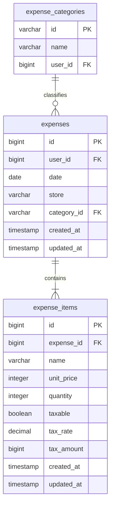

# 家計簿DB設計とAPI v1

共通Laravelが家計簿API・認証・DBマイグレーションを管理する。クレカ管理画面は独立したcredit-card-frontへ分離し、両SPAから同じLaravelのJSON APIへ接続する。DBは既存MySQLの `kakeibo` を共通利用する。

## ER構成（家計簿の主要テーブル）



- `expense_categories`: 初期9カテゴリは共通マスタ。設定画面で追加する独自カテゴリはユーザー別で、`(user_id, name)` に一意制約を持つ。APIで共通名・本人の既存名との重複も検証する。カテゴリの編集・削除APIは未実装。
- `expenses`: 支出1件（レシート相当）。日付・店舗、`(user_id, date)` にインデックス。店舗は入力値を保存し、候補は重複を除いて返す。
- `expense_items`: 支出に属する品目。親支出削除時に連動削除。登録は親子まとめてトランザクションで行う。
- 金額は日本円の整数。合計金額は保存せず、品目の単価×数量＋品目税額から算出し、不整合を防ぐ。月次集計はSQLで集約する。
- APIではIDは文字列、金額・数量は数値、日付は `YYYY-MM-DD`。DBのsnake_caseをResourceで画面のcamelCaseへ変換。
- 単価0〜100,000,000円、数量1〜10,000、品目1〜100件。日付は1000〜9999年の有効日付。小数・負数は受け付けない。
- メールアドレス・パスワードで新規登録・ログインする。支出・独自カテゴリ・CSV履歴はユーザーごとに分離し、API全体を認証で保護する。
- クレカ明細との連携、支出削除、カテゴリ編集は今回のAPI範囲外。

## マイグレーション

`household-env` で実行する。

```bash
docker compose exec kakeibo-app php artisan migrate --force
docker compose exec kakeibo-app php artisan migrate:status
```

`database/migrations` には家計簿テーブルに加え、CSV履歴、ユーザー分離、品目税額、月予算、クレカ管理のマイグレーションがある。最新の未適用分を適用し、適用済みファイルは書き換えない。開発構成では `docker compose -f compose.dev.yml exec kakeibo-app php artisan migrate` を使う。ロールバックでデータを失う可能性があり、ユーザー分離は自動rollbackを拒否する。`migrate:fresh` は使わない。

## エンドポイント

直接: `http://localhost:8080/api/v1`。Docker家計簿フロント経由: `http://localhost:5174/api/v1`。

| メソッド | パス | 内容 |
|---|---|---|
| POST | `/expenses` | 支出と品目を登録（201） |
| GET | `/expenses?date=2026-09-06` | 指定日の支出一覧（ID昇順） |
| GET | `/monthly-summary?year=2026&month=9` | 月次合計・日別金額と件数・カテゴリ別金額と構成比 |
| GET | `/expenses/{id}` | 品目を含む支出1件を取得 |
| PUT | `/expenses/{id}` | 支出と品目を更新 |
| GET | `/categories` | 共通カテゴリと本人の独自カテゴリを取得 |
| POST | `/categories` | 本人の独自カテゴリを追加 |
| GET | `/monthly-budget?year=2026&month=9` | 月全体・カテゴリ別予算を取得 |
| PUT | `/monthly-budget` | 指定月の予算を全体置換 |
| GET | `/stores` | 登録済み店舗の候補（重複除外、DBの照合順） |

`Accept: application/json` を使用し、JSONのPOST・PUTは `Content-Type: application/json` で送信。成功時は `data` ラッパーなしで返す。入力エラーは422で `message` とフィールド別 `errors` を返す。

登録リクエスト例:

```json
{"date":"2026-09-06","store":"スーパー","category":"food","items":[{"name":"りんご","unitPrice":150,"quantity":2}]}
```

登録レスポンス例:

```json
{"id":"1","date":"2026-09-06","store":"スーパー","category":"food","items":[{"id":"1","name":"りんご","unitPrice":150,"quantity":2,"taxable":false,"taxRate":0,"taxAmount":0}],"total":300}
```

日別一覧は上記支出オブジェクトの配列。対象がなければ空配列。

月次レスポンス例:

```json
{"year":2026,"month":9,"total":300,"dailyTotals":[{"date":"2026-09-06","amount":300,"count":1}],"categoryTotals":[{"category":"food","amount":300,"percentage":100}]}
```

日別は日付昇順、カテゴリは金額降順。構成比は小数第1位に丸め、合計0円なら0。空月は合計0と空配列を返す。件数は品目数ではなく支出件数。

## 品目ごとの税計算

POST・PUTの各品目に任意の `taxable` と `taxRate` を指定できる。`taxable: true` の場合は税率必須で、0〜100%、小数点以下2桁まで。省略・falseの場合は税率・税額とも0になる。税額はサーバーで `floor(単価 × 数量 × 税率 / 100)` を品目ごとに計算し、1円未満を切り捨てる。クライアントから `taxAmount` は送信しない。

レスポンスの各品目は `taxable`、`taxRate`、`taxAmount` を含み、支出の `total` と日別・月別集計は税額を含む。CSV共通テンプレートには税列がなく、取込時は税加算なしで保存する。取込後の編集で税を指定できる。

## 月予算

`GET /monthly-budget?year=2026&month=9` と `PUT /monthly-budget` は認証必須。PUTの入力とGET・PUTのレスポンスは同形式。

```json
{"year":2026,"month":9,"amount":100000,"categoryBudgets":[{"category":"food","amount":30000}]}
```

- 年は1000〜9999、月は1〜12。`amount` と `categoryBudgets` はPUTで必須。
- 月全体の `amount` は0〜999,999,999,999円の整数、未設定は `null`。カテゴリ別は同範囲の整数で、最大100件。参照可能なカテゴリを重複なく指定する。
- 未設定月は `amount: null`、`categoryBudgets: []` を返す。0円と未設定は区別する。
- PUTはカテゴリ別予算を全体置換し、省略したカテゴリの予算は削除する。`amount: null` と空配列で全予算を未設定にできる。
- `monthly_budgets` は `(user_id, year, month)`、`monthly_category_budgets` は `(monthly_budget_id, category_id)` を一意にし、トランザクションで保存する。
- 使用額・残額・超過・進捗はSPAが月次集計と予算から表示する。月全体とカテゴリ別の合計一致は要求しない。

## フロント接続と検証

### カテゴリ管理

`GET /api/v1/categories` は共通カテゴリと本人の独自カテゴリを `[{id, name}]` 形式で返す（名前順）。`POST /api/v1/categories` はJSON `{ "name": "お酒" }` を受け、201で `{id, name}` を返す。追加カテゴリのIDはサーバー生成のULIDで、既存カテゴリIDは変更しない。

名前は前後の空白・全角空白を除去し、必須・50文字以内・改行／制御文字なし・重複なしを検証する。CSVで名前とIDの解釈が衝突しないよう、既存IDと同じ名前も拒否する。入力エラーは422の `errors.name`。DBの一意制約により同名の同時登録も防ぐ。

名前全体の一意制約は、ユーザー分離マイグレーション `2026_09_07_000003_scope_household_data_to_users.php` で `(user_id, name)` の一意制約に置き換え済み。追加カテゴリは通常の支出登録・CSV取り込み・集計で利用可能。名称変更・削除・表示色の編集は今回の機能には含めない。

### CSVインポート

設定画面 `/#/settings/import` から共通テンプレートCSVを取り込む。

| メソッド | パス | 内容 |
|---|---|---|
| POST | `/expense-imports/preview` | 全行の検証・件数・合計・先頭20件のプレビュー（200、保存なし） |
| POST | `/expense-imports` | 全行を再検証し一括登録（201、取り込み済みなら200） |

いずれも `/api/v1` 配下。multipart/form-dataで `file` と `encoding`（`UTF-8` / `SJIS-win`）を渡す。

CSVのヘッダーは `日付,店舗,カテゴリ,品目,単価,数量` の順。UTF-8 BOM、Shift_JIS、引用符で囲まれたカンマ・改行、二重引用符のエスケープに対応。空行は無視し、1行を1支出・1品目として保存する。カテゴリは日本語ラベルまたはID。単価・数量は桁区切りのない整数。他の範囲は通常の支出登録と同じ。1ファイル2MB・1,000支出まで。

プレビューは `{count, total, rows, alreadyImported, unknownCategories}`。`rows` は先頭20件の `{line, date, store, category, items}`。未登録カテゴリの行には `categoryName` も返す。`unknownCategories` は全行を対象に未登録名を重複除外した配列。`line` はCSV内の物理行番号。登録結果は `{importedCount, alreadyImported}`。重複時は `importedCount: 0`。422時は `errors.file` / `errors.encoding` / `errors.rows` にメッセージを返す。行エラーは最大50件を返し、部分登録しない。

フロントで未登録名を一覧表示し、ユーザーが明示的に承認した場合だけ、登録リクエストの `approved_categories[]` に承認された名前を送る。未承認の新規カテゴリがあれば422の `errors.categories` で拒否する。空欄・50文字超・改行や制御文字を含むカテゴリはプレビュー時に拒否する。カテゴリ作成・支出・履歴を同一トランザクションで保存し、失敗時はすべてロールバックする。プレビューではカテゴリを保存しない。再送時は登録済みカテゴリのIDで正規化して従来のハッシュと照合し、二重登録を防ぐ。

`2026_09_07_000001_create_expense_imports_table.php` で `expense_imports` を追加する。現在のカラムは `id`、`user_id`、`fingerprint`（SHA-256）、`expense_count`、`created_at`。ユーザー分離マイグレーションで `(user_id, fingerprint)` を一意にしている。正規化した全支出と行順のハッシュを記録し、同じ内容の再送・同時送信を一意制約で防ぐ。履歴と支出・品目は同一トランザクションで保存するため、途中で失敗しても全件ロールバックできる。元ファイルは保存しない。

この仕組みはファイル単位の再送防止であり、既存支出との行単位の重複判定ではない。行を追加・変更・並べ替えたファイルは別の取り込みになる。重複判定は本人の取込履歴に限定する。

### 自動テスト

家計簿の `ExpenseApi` インターフェースに合わせたレスポンスを実装済み。フロントの `HttpExpenseApi` から認証・支出・集計・予算・カテゴリ・CSVの各APIへ接続する。標準構成ではnginx、開発構成ではViteが `/api/` をLaravelへ転送する。標準APIイメージは開発用依存を含まないため、テストは依存導入済みの開発構成で実行する。

```bash
docker compose -f compose.dev.yml exec kakeibo-app php artisan test
```

FeatureテストはSQLiteのインメモリDBを利用し、共通MySQLの実データを消去しない。登録・明細保存・日別絞り込み・月境界・集計・店舗重複除外・空月・0円・入力検証・トランザクションを確認する。

## 支出の編集

- `GET /api/v1/expenses/{id}`: 品目を含む支出1件を取得。存在しないIDは404。
- `PUT /api/v1/expenses/{id}`: POSTと同じ日付・店舗・カテゴリ・品目の全体を送信し更新。200で更新後の支出を返す。入力制約は新規登録と共通。
- 親支出IDを維持し、品目はトランザクション内で置き換える（品目IDは再採番）。失敗時は親子とも元に戻る。日次・月次集計は更新内容から計算する。
- CSV取り込み済み支出も編集可能。取り込み履歴は維持し、同じCSVの再取り込みで編集内容を上書きしない。

## 認証とユーザー分離

Laravel標準のwebセッションガードをJSON APIから利用する。APIのwebミドルウェアがCookie暗号化・セッション・CSRF検証を実施する。トークン認証は今回使用しない。

- `GET /api/v1/auth/session`: `{user: {id,name,email} | null, csrfToken}`。未ログインでも200。Cache-Controlはno-store。
- `POST /api/v1/auth/register`: `{name,email,password,password_confirmation}`。名前100文字以内、メール255文字以内、パスワード12文字以上・UTF-8で72バイト以内（bcryptの上限）、NUL不可、確認一致。201でセッション情報を返す。
- `POST /api/v1/auth/login`: `{email,password}`。成功200。失敗422、連続失敗5回/分・IP単位20回/分で429。
- `POST /api/v1/auth/logout`: セッション無効化・CSRF再発行、200で未ログインのセッション情報を返す。
- すべての更新リクエストにセッションCookieと`X-CSRF-TOKEN`を送る。ログイン・ログアウト時に再発行されたCSRFトークンへ更新する。401/419なら再ログインし、自動で書き込みを再送しない。
- メールは前後空白を除き小文字に正規化。パスワードはUserモデルのhashedキャストでハッシュ化し、レスポンスに含めない。
- 新規登録は公開（IP単位5回/分）。メール確認・パスワード再設定メールは未実装。
- 全家計簿APIは認証必須。データの所有者はサーバーで決定し、リクエストのuser_idを信用しない。他ユーザーの明細IDは404。日別・月別・店舗候補・独自カテゴリ・CSVプレビューと重複判定も本人の範囲に限定する。
- 初期9カテゴリのみ読み取り専用の共通マスタ。追加カテゴリは本人のみ参照でき、名前の一意性はユーザー単位。

### 既存データの引き継ぎ

マイグレーションは所有者未設定の既存データを保持し、新規ユーザーには公開しない。管理者が対象ユーザーの新規登録と本人の依頼を確認後、次を一度実行する。Webから引き継ぐエンドポイントは設けない。

```bash
php artisan expenses:assign-legacy owner@example.com
```

対象アカウントが未作成なら変更しない。同名の独自カテゴリが既にある場合は全処理を中止する。安全のためユーザー分離マイグレーションの自動rollbackは不可。

### クラウド配置

同一オリジンで`/api`をLaravelへ転送する構成、または同一サイト内のHTTPSサブドメイン構成を利用する。別サービスの無関係なドメイン同士ではサードパーティCookie制限があるため、カスタムドメインかリバースプロキシを用意する。

現行のSPA Dockerfileは `VITE_API_BASE_URL=/api/v1` でビルドし、フロントnginxの `BACKEND_HOST` に指定したLaravelホストへ転送する。Laravelは`FRONTEND_ORIGINS`に許可するフロントの正確なオリジンを設定し、`SESSION_SECURE_COOKIE=true`、`APP_DEBUG=false`とする。セッションCookieはHttpOnly、CSRFトークンはJSメモリのみ。CORSは認証の代わりにはならない。DB接続を設定して`php artisan migrate --force`を実行する。

### 将来のGoogleログイン

支出の所有者はメールではなく既存の`users.id`で固定する。Google認証追加時はSocialite等の検証済みOAuthライブラリでログインし、同じwebセッションを発行する。Googleのprovider subjectとusers.idを対応させる外部IDテーブルをその時点で追加する。未確認メールの一致だけで既存アカウントへ自動連携せず、ログイン済みユーザーの明示的な連携と本人確認を行う。今回はGoogleボタン・OAuth経路・外部IDテーブルは追加していない。
